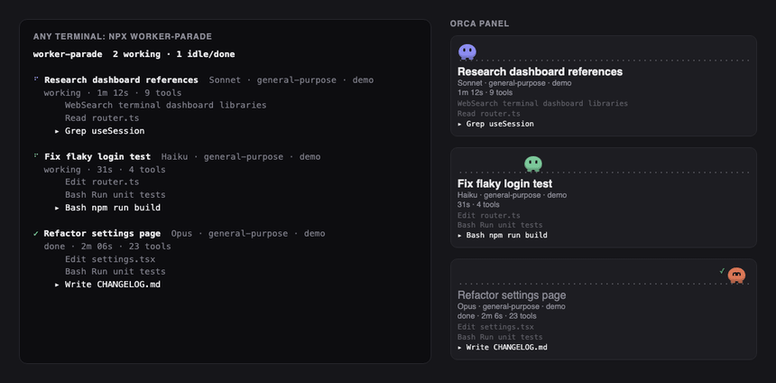

# worker-parade

**Is my background agent still working, stuck, or done?**

Background coding agents (Claude Code subagents) run for minutes and say nothing. worker-parade shows every one of them at a glance: what it is, how long it has run, how many tools it used, and the last three things it did, as a live ticker.



*Sample data. Left: any terminal. Right: the Orca panel.*

```
⠋ Research dashboard references  Sonnet · general-purpose · demo
  working · 1m 12s · 11 tools
      Grep useSession
      Edit router.ts
    ▸ Bash Run unit tests
```

- Working, quiet (no transcript writes for 10+ minutes) or done, per worker.
- Last 3 actions per worker: `Read router.ts`, `Bash Run unit tests`, `WebSearch query…`
- Secret-looking strings (`sk-…`, `ghp_…`, `xox…`, bearer tokens, long hex/base64) are redacted. File contents and tool results are never read into the output.

## Install

**Any terminal** (tmux pane, VS Code / Cursor integrated terminal, plain shell). Node 18+.

```bash
npx github:METHEZONE/worker-parade watch     # live view
npx github:METHEZONE/worker-parade once      # print once
npx github:METHEZONE/worker-parade --json    # for scripts
```

From a clone: `node bin/parade.mjs watch`. Add `--demo` to try it with sample data. Ctrl-C quits.

**Claude Code plugin** (walking characters above the prompt, `/workers` toggles them):

```
/plugin marketplace add METHEZONE/worker-parade
/plugin install worker-parade@worker-parade
```

**Orca panel** (Orca 1.4.246+). Load the `orca/` folder; it imports `../core`, so keep `core/` next to it (as in this repo):

```bash
git clone https://github.com/METHEZONE/worker-parade && cd worker-parade
orca plugin dev load ./orca --json    # prints an approval fingerprint (it runs a local Node worker)
orca plugin dev load ./orca --json --approve <fingerprint>
orca plugin open local.worker-parade --panel parade
```

The plugin's own worker tails the transcripts and the panel asks it for updates every 1.5s, patching cards in place. Nothing to keep running. (0.3.0 used an external `parade.mjs` writer that rewrote `panel.html`, which made Orca reload the panel on every change; stop it if you had it running.)

## Zero token cost, local only

worker-parade never calls a model and never touches the network. It tails the transcript files Claude Code already writes to `~/.claude/projects/*/*/subagents/*.jsonl`, reading only the bytes appended since the last check, and renders what it finds. No dependencies, Node stdlib only. Nothing is uploaded, logged, or stored.

## How it works

```
core/activity.mjs   one tool call -> one short redacted line (pure)
core/parade.mjs     transcript scanner -> worker records
core/text.mjs       terminal renderer          -> bin/parade.mjs
orca/worker.mjs     Orca plugin worker: scanner -> panel on request
orca/panel.html     static Orca panel; orca/patch.mjs updates cards in place by id
hooks/register.tsx  Claude Code plugin band    (uses core/activity.mjs)
```

## Develop

```bash
npm test                          # parser, redaction, scanner, renderer, panel patcher
claude plugin test .              # the Claude Code plugin's own tests
node tools/make-demo.mjs          # regenerate docs/demo.* (needs playwright + ffmpeg)
```

## Next

- Codex CLI (`~/.codex/sessions`): its rollout logs record tool calls too, but not a clean per-task "finished" marker, so it is not wired in yet.
- Other agent hosts via the same `core/` record shape.

## License

MIT
